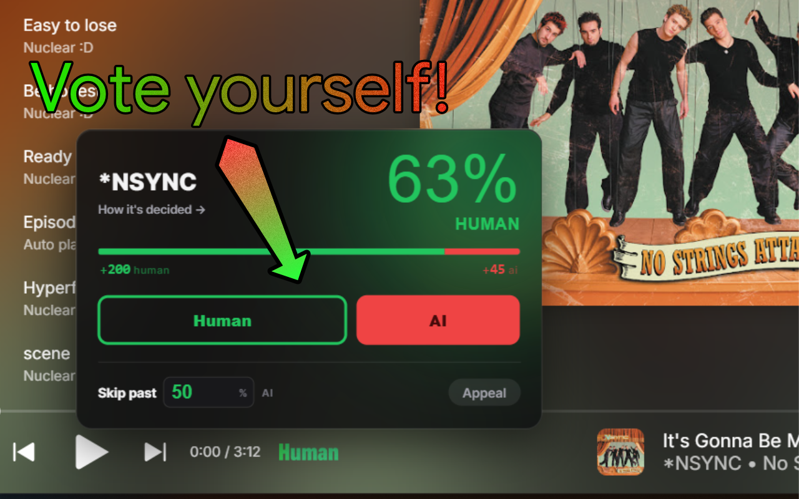

# SoundProof - Detect, skip, and vote. A community-powered AI music blocklist

## Don't want to worry about staying up to date? [Get it on the Chrome Web Store!](https://chromewebstore.google.com/detail/detect-skip-ai-music-soul/mbfhdilbcdcnhbaakndiofeahchaclpa?authuser=0&hl=en)
(I would greatly appreciate the ego boost of getting a download on the web store, too!)

## Beginning work on SoundProof 6.5! https://github.com/NuclearBlox/SoundProof-extension/issues/35

> [!IMPORTANT]
> If you are here because you are an artist/fan who feels unfairly blocked, you're in luck! [appeal here!](https://github.com/NuclearBlox/SoundProof-extension/wiki/Appealing-an-incorrect-rating)

A Chrome extension that watches your music streaming platform of choice to tell you whether a human or a data center made the song you’re listening to!

It automatically checks the current track against SlopCall, an API built specifically for this extension

## Supports: Spotify, YouTube Music, SoundCloud, Apple Music

~~Very basic right now, much to be improved!~~
**Not that basic anymore**

